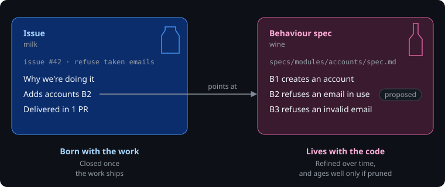
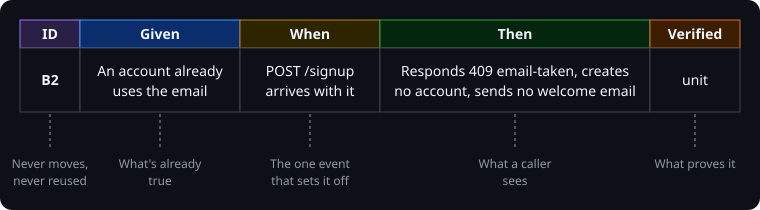
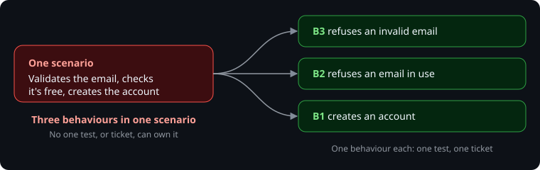
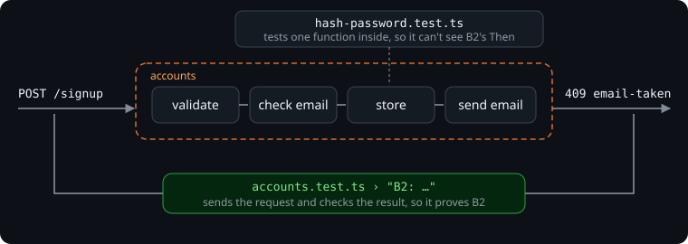
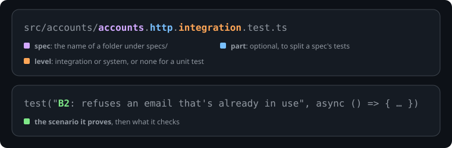
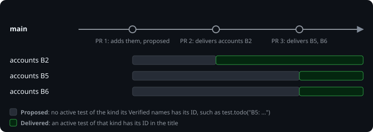
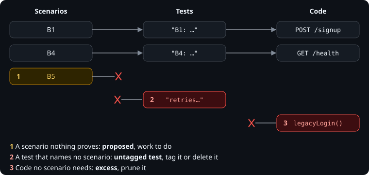
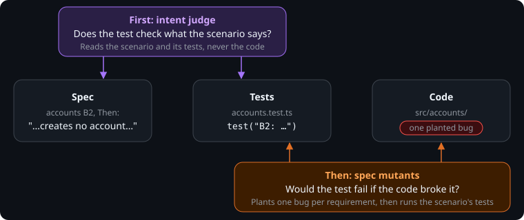
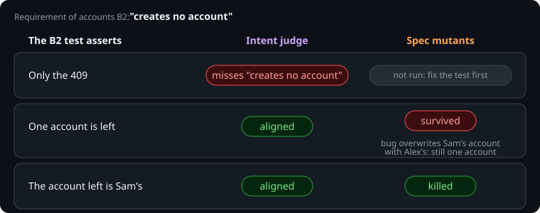

# Spec-driven development

In [this repository](https://github.com/Nhollas/milk-and-wine), I've recently been experimenting with how I practise spec-driven development.

With agents writing more of our code, the bottleneck is shifting towards collaborating and aligning on what the systems we build should do. Verification is the other half: trusting that the code an agent wrote does exactly what was agreed. That matters because people are still accountable for the software they ship.

## 1. Two kinds of spec

My general thinking is that a spec is where people write down what a system should do, as short, plain statements a reader can check. Specs stay short, because people have to read one before they can agree with it.

I've tried tools like GitHub Spec Kit, and their specs haven't aged well. Each is written for one change and kept in the codebase afterwards, where it soon becomes unreadable. An agent needs a spec while it builds, but once the change is done, I don't see what value keeping it has.

So I keep two different things apart. An **issue** describes one piece of work. It says why we're doing it and what it will change, and it's useful only while the work is happening. So it never goes in the codebase: it's an issue on GitHub, broken down into tickets, and closed once the work has shipped. A **behaviour spec** describes what one part of the system does today. It lives next to the code and changes whenever the behaviour does, so it's useful for as long as the system exists.

I call them milk and wine, because one goes off and the other ages.

## 2. Where this sits

Birgitta Böckeler's [article on spec-driven tools](https://martinfowler.com/articles/exploring-gen-ai/sdd-3-tools.html) sorts approaches by how long the spec lives. A spec-first spec is written for one task and then left behind, so an issue is spec-first. A spec-anchored spec is kept and maintained with the feature, so a behaviour spec is spec-anchored.

The third level, spec-as-source, has people edit only the spec and never the code. I'm not aiming for that. Behaviour specs leave things out on purpose, so they couldn't regenerate the code anyway.

| If you know | What's the same | What's different |
| --- | --- | --- |
| [GitHub Spec Kit](https://github.com/github/spec-kit) or [Kiro](https://kiro.dev) | A spec is written and agreed before an agent builds anything | Their specs mostly live for one change. Here the spec that matters is the behaviour spec, which outlives the change |
| [OpenSpec](https://github.com/Fission-AI/OpenSpec) | Lasting specs are kept apart from change proposals, which are archived once the work is done | An OpenSpec change carries its own copy of the requirements. Here an issue only points at scenarios in a behaviour spec, and lives in the issue tracker rather than the codebase |
| [Tessl](https://tessl.io) | Specs live next to the code for the long run | Tessl explores generating the code from the spec. Here code is written as normal |
| [Behaviour-driven development](https://en.wikipedia.org/wiki/Given-When-Then) | Each scenario is written as a Given, When and Then | There's no Gherkin runtime or step definitions. Scenarios sit in a table in a markdown file, and ordinary tests name the scenario they prove |
| [Mutation testing](https://stryker-mutator.io/docs/) | Plant a bug in the code and see if the tests notice | Bugs are planted only against what a scenario says, and only after the intent judge has passed the test |

## 3. Starting a change

To make this concrete, let's follow one change through a sign-up API. It's a made-up example, picked because everyone has signed up for something. The change makes sign-up refuse an email address that another account already uses.

The work starts with an issue on GitHub. It says why the work is happening and what the API should do differently once it's done.

That last part goes into the behaviour spec for accounts, which describes everything about creating accounts, rather than into the issue. Each statement in a behaviour spec is called a **scenario**, and this change adds one, numbered B2. The issue just points at B2, so closing the issue later loses nothing.



## 4. Writing a scenario

A behaviour spec is a table of scenarios. Each is written in enough detail that someone could check it. Each has an ID, such as B2, so tests and tickets can refer to it, and four parts.

- **Given** is the situation that's already true before anything happens.
- **When** is the one event that sets it off.
- **Then** is what someone watching from outside sees as a result.
- **Verified** names how the scenario is proved, usually by a kind of test, but sometimes by a guarantee from something we depend on, or by a manual check.

Here's B2, the scenario this change adds to the accounts spec.



Each scenario describes one behaviour, so a failing test says exactly which behaviour broke, and the work can be split into separate tickets. A scenario that tries to do three things gets split into three.



An ID never changes and is never reused, so B2 in a test's name always means the same thing. When a scenario is no longer needed it's removed, even if the code still does it, and its ID is retired with it.

## 5. Testing from the outside

B2's Then is what a caller of the API sees, a `409` and no new account. So the test that proves it has to check those, and the plainest way is to call the API the way a real client would. It sends `POST /signup` and checks the response and what the request left behind, without calling any of the code's functions directly. It's still a unit test: the app runs in the test's process, with a fake standing in for the email service.



Tests that check one function inside are welcome too. They help while building, and they can prove a scenario whose Then they check, but not B2, because no caller of that function ever sees a `409`.

## 6. Linking tests to scenarios

A test names the scenario it proves at the start of its title. The test for B2 is called "B2: refuses an email that's already in use". Its file name says which spec it belongs to and, unless it's a unit test, what kind of test it is, so `accounts.test.ts` holds unit tests for the accounts spec and `accounts.integration.test.ts` its integration tests.



Both are needed because every spec has its own B1, B2 and so on, so the file name says which spec's B2 a test means ([ADR 0002](adr/0002-test-file-names-carry-subject-and-level.md), [ADR 0005](adr/0005-unit-tests-can-prove-scenarios.md)).

Here's the B2 test in full. Sam signs up, then Alex tries to sign up with the same email.

```ts
test("B2: refuses an email that's already in use", async ({ app, fakeEmailClient, db }) => {
  await app.request("/signup", {
    method: "POST",
    headers: { "Content-Type": "application/json" },
    body: JSON.stringify({ email: "sam@example.com", name: "Sam" }),
  });

  const secondSignupResponse = await app.request("/signup", {
    method: "POST",
    headers: { "Content-Type": "application/json" },
    body: JSON.stringify({ email: "sam@example.com", name: "Alex" }),
  });

  expect(secondSignupResponse.status).toBe(409);
  expect(await secondSignupResponse.json()).toEqual({ error: "email-taken" });
  expect(db.prepare("SELECT email, name FROM accounts").all()).toEqual([
    { email: "sam@example.com", name: "Sam" },
  ]);
  expect(fakeEmailClient.sent).toEqual([{ to: "sam@example.com", template: "welcome" }]);
});
```

Each assertion checks one part of B2's Then.

The code that makes it pass is one line, which refuses the email before an account is created or an email is sent.

```ts
if (store.hasAccount(email)) return c.json({ error: "email-taken" }, 409);

store.insert(account);
await emailClient.sendWelcome(email);
```

## 7. Finding the gaps

The link between a test and its scenario also decides which scenarios are done, so nobody marks one by hand. A scenario is proposed until a test of the right kind carries its ID, and delivered once one does.



So scenarios can be added to a spec before any code exists, agreed first and delivered as the work for each one lands.

Because scenarios, tests and code are linked, anything missing shows up as a broken link. There are three kinds.

- A scenario with no test is still proposed.
- A test that names no scenario either needs one or isn't needed.
- Code that no scenario asks for can probably be removed.



I look for these in every review, but the link only goes as far as a test's title. A test can be called B2 and check something B2 doesn't say, or check it so loosely that a bug gets through.

## 8. Checking a test proves its scenario

So I added two checks, each run by an agent, that look past a test's title.

The intent judge reads a scenario and its tests but never the code, so it judges a test by what the scenario says, not by what the code happens to do. It splits the scenario into its requirements, such as "creates no account", and looks for where the tests check each one. Spec mutants plant one small bug in the code at a time and run the scenario's tests, and any bug the tests still pass with is one they missed.



Each check catches problems the other can't. Take one part of B2, that the API "creates no account" when it refuses. Here are three ways a B2 test might check it, and what each check makes of them.



The second test shows why both are needed. It checks that one account is left, so the judge accepts it. But a mutant can overwrite Sam's account with Alex's details, and the test still passes.

The judge runs first. If a mutant gets past a test the judge hasn't passed, there's no telling whether the test checks the wrong thing or checks the right thing too loosely.

Neither check can find a behaviour that's missing from both the code and the tests. Only a person reading the scenario can do that.

How each check works is written up for the [intent judge](../.claude/agents/intent-judge/intent-judge.md) and the [spec mutants](../specs/tools/spec-mutants/spec.md). The targets each one has to hit are in [INTENT.md](../INTENT.md#review-checks).

## 9. Delivering a change

The intent judge and spec mutants are two steps in how a change gets from an idea to merged code. [The workflow](workflow.md) covers the rest: agreeing the spec in a shared doc, slicing the change into tickets, and running the two checks on each ticket once it's built.
