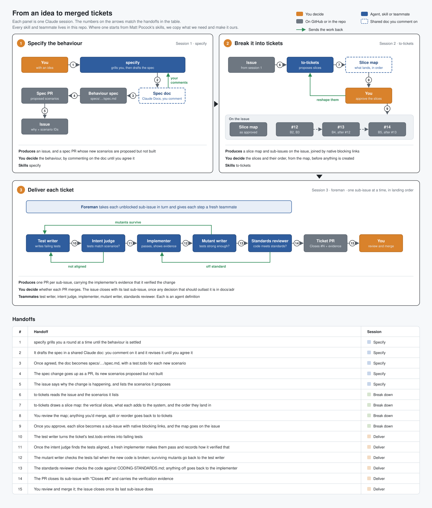

# Workflow

How a change gets from an idea to merged code. It takes three Claude sessions, and each one starts fresh from what the last left on GitHub or in the repository.

## Where things live

Only the wine goes in the repository. Everything about one piece of work lives on GitHub and closes when the work is done.

| What | Where | Lasts |
| --- | --- | --- |
| Why the change is happening, and the scenarios it proposes | An issue | Until its last ticket merges |
| The slices of work, what each adds and the order they land in | The slice map: an image on the issue | As long as the issue |
| One slice of the work | A ticket: a sub-issue, with blocking links | Until its PR merges |
| What the system does | A behaviour spec under `specs/` | For as long as the system does it |
| A decision that should outlast the change | An ADR under `docs/adr/` | Until it's superseded |

## 1. Specify the behaviour

Run `/specify` with the subject or idea. It grills you a round at a time until the behaviour is settled, then drafts the spec in a shared Claude doc. You comment on the doc and it revises it, until you say it's agreed.

Only then is the spec written to `specs/`, with a `test.todo` for each new scenario. The spec change goes up as a PR, and an issue is opened saying why and listing the scenarios it proposes. Once you merge the PR, the new scenarios are proposed: specced, but not built.

## 2. Break it into tickets

Run `/to-tickets` with the issue. It slices the change vertically, so each ticket delivers one or more scenarios end to end and fits in one fresh session.

Before anything is created, it draws a slice map: the system, what each ticket adds to it, and the order they land in. You say what to merge, split or reorder until the map is right. Then it creates each ticket as a sub-issue, with native blocking links, and attaches the map to the issue.

It needs GitHub CLI 2.94 or later, for `--parent`, `--blocked-by` and `--attach`, and `rsvg-convert` to turn the map into a PNG (`brew install librsvg`).

## 3. Deliver each ticket

Run `/foreman` with the issue. Foreman leads an agent team. It takes each ticket with no open blockers in landing order, gives it a branch, and passes it through five teammates, starting a fresh one for each step. A ticket blocked by an unmerged PR waits for you to merge it; run `/foreman` again to carry on.

| Teammate | Does | Foreman sends the work back to |
| --- | --- | --- |
| Test writer | Turns the ticket's `test.todo` entries into failing tests |  |
| Intent judge | Checks the tests check what their scenarios say | The test writer, when they don't |
| Implementer | Makes the tests pass, and records how it verified the change |  |
| Mutant writer | Checks the tests fail when the new code is broken | The test writer, when a mutant survives |
| Standards reviewer | Checks the change against [CODING-STANDARDS.md](../CODING-STANDARDS.md) | The implementer or test writer, when it doesn't meet them |

The ticket then goes up as a PR that closes its sub-issue and carries the implementer's evidence. You review and merge it. Once the last ticket merges, move any decision that should outlast the change into an ADR, and close the issue.

Each teammate is an agent definition that knows only its own input and output: it's given a subject and scenario IDs, and replies with its result. Foreman is the only part that knows the order, and routes each finding to whoever fixes it. A teammate becomes a plugin once it has an eval suite, as the intent judge has.

Tickets run one at a time, in the main checkout, because the intent judge's and mutant writer's guards resolve paths against the project directory, not a worktree. Agent teams are turned on in [the project settings](../.claude/settings.json), which also makes any subagent given a name a teammate.

## What's built

Everything here exists, but none of it has delivered a change yet.
